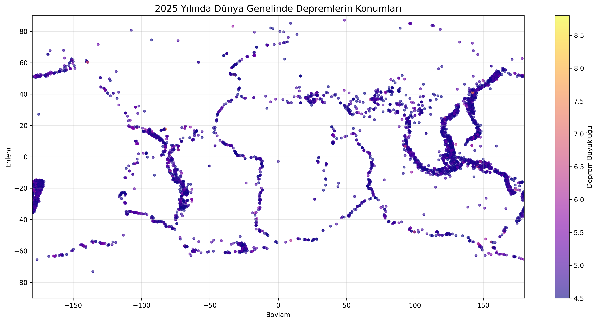

# Global Earthquake Data Analysis

## Proje Amacı

Bu projede, 2025 yılında dünya genelinde meydana gelen 4.5 ve üzeri büyüklükteki depremler analiz edilmiştir.

Veriler USGS Earthquake API üzerinden Python kullanılarak toplanmış, temizlenmiş ve görselleştirilmiştir. Çalışmada depremlerin aylık dağılımı, büyüklük–derinlik ilişkisi ve coğrafi yoğunlukları incelenmiştir.

## Veri Kaynağı

- **Kaynak:** [USGS Earthquake Catalog](https://earthquake.usgs.gov/fdsnws/event/1/)
- **Dönem:** 1 Ocak – 31 Aralık 2025
- **Deprem sayısı:** 8.559
- **Minimum büyüklük:** 4.5
- **Veri toplama tarihi:** 20 Kasım 2026
- **Kullanılan alanlar:** Deprem kimliği, büyüklük, büyüklük türü (`magType`), konum, zaman, enlem, boylam ve derinlik

## Araştırma Soruları

1. Depremler aylara göre nasıl dağılıyor ve temmuz ayındaki artış hangi bölgelerde yoğunlaşıyor?
2. Deprem büyüklüğü ile derinliği arasında ilişki var mı? Bu ilişki büyüklük türlerine göre değişiyor mu?
3. Depremler dünya genelinde hangi coğrafi bölgelerde yoğunlaşıyor?

## Yöntem

1. USGS API üzerinden 2025 yılına ait deprem verileri aylık sorgularla toplandı.
2. Veri toplama koduna başarısız istekleri yeniden deneme ve aylık verileri ayrı kaydetme mekanizması eklendi.
3. Tekrar eden kayıtlar deprem kimliğine göre kontrol edildi.
4. Eksik değerler, koordinatlar ve büyüklük bilgileri incelendi.
5. Veriler pandas kullanılarak temizlendi ve CSV formatında kaydedildi.
6. Matplotlib kullanılarak istatistiksel analizler ve görselleştirmeler hazırlandı.
7. Bölgesel deprem dağılımı, büyüklük türleri ve dünya haritası için ek analizler geliştirildi.

## Bulgular

### 1. Aylık Deprem Dağılımı


2025 yılında en fazla deprem **temmuz ayında (1.321)**, en az deprem ise **mart ayında (539)** kaydedilmiştir.

Aylık ortalama deprem sayısı **713,25** olarak hesaplanmıştır.

Temmuz ayındaki artışı daha ayrıntılı incelemek amacıyla konum açıklamaları üzerinden bölgesel analiz yapılmıştır. Temmuz ayında kaydedilen 1.321 depremin 704'ünün (%53,3) konum açıklaması Rusya ile bitmektedir.

Bu bulgu, temmuz ayındaki yüksek deprem sayısının belirli coğrafi bölgelerde yoğunlaştığını göstermektedir.

### 2. Deprem Büyüklüğü ve Derinlik İlişkisi


Deprem büyüklüğü ile derinliği arasındaki Pearson korelasyon katsayısı **-0,046** olarak bulunmuştur.

Bu değer, iki değişken arasında çok zayıf negatif doğrusal ilişki olduğunu göstermektedir.

Ayrıca depremlerin farklı büyüklük türlerinde raporlanabileceği dikkate alınarak `magType` dağılımını ve türlere göre büyüklük–derinlik ilişkisini inceleyen ek analizler geliştirilmiştir.

### 3. Depremlerin Coğrafi Dağılımı



Depremlerin dünya üzerinde homojen dağılmadığı, belirli tektonik bölgelerde yoğunlaştığı gözlemlenmiştir.

Özellikle Japonya, Endonezya, Alaska ve Güney Amerika'nın batı kıyılarında deprem kümelenmeleri dikkat çekmektedir.

Bu dağılım, tektonik levha sınırları boyunca görülen deprem hareketliliğiyle uyumludur.

Coğrafi dağılımı daha anlaşılır göstermek amacıyla dünya haritası üzerinde deprem konumlarını görselleştiren ek kod geliştirilmiştir.

## Sınırlılıklar

- Analiz yalnızca 2025 yılını kapsamaktadır.
- Sadece 4.5 ve üzeri büyüklükteki depremler incelenmiştir.
- USGS kayıtları zaman içerisinde güncellenebilir.
- Farklı büyüklük türleri arasındaki ölçüm farklılıkları sonuçları etkileyebilir.
- Bölgesel sınıflandırma konum açıklamalarına dayandığından yaklaşık sonuçlar verir.
- Tek yıllık verilerden uzun dönemli veya mevsimsel deprem eğilimleri çıkarılamaz.

## Kullanılan Teknolojiler

- Python
- Google Colab / Jupyter Notebook
- pandas
- requests
- Matplotlib
- Cartopy
- USGS Earthquake API

## Çalıştırma

Gerekli Python kütüphanelerini yüklemek için:

```bash
pip install -r requirements.txt
```

1. `notebooks/global_earthquake_analysis.ipynb` dosyasını açın.
2. Projenin veri klasörünün erişilebilir olduğundan emin olun.
3. Mevcut ham verileri kullanmak için `USE_EXISTING_RAW = True` ayarını seçin.
4. Notebook hücrelerini sırasıyla çalıştırın.
5. İşlenmiş veriler `data/processed`, grafikler ise `figures` klasörüne kaydedilir.
