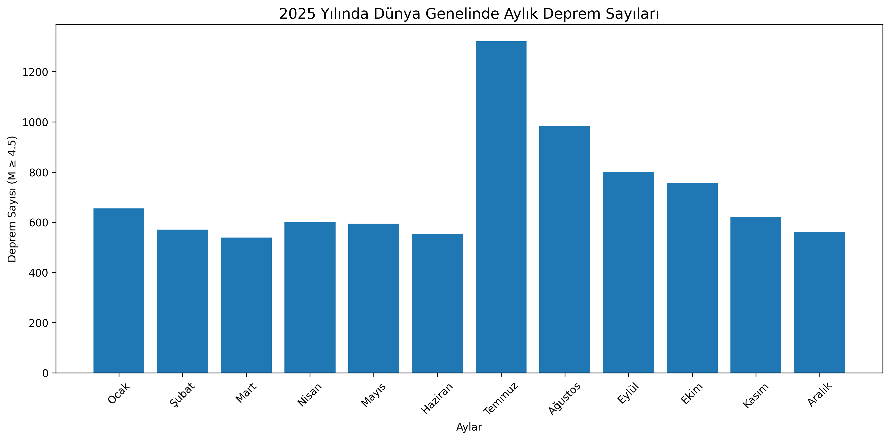
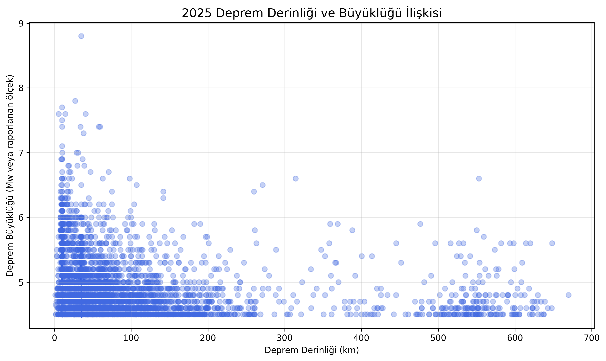

# Global Earthquake Data Analysis

## Proje Amacı
Bu projede, USGS Earthquake API'den elde edilen, 2025 yılında dünya genelinde raporlanmış **4.5 ve üzeri büyüklükteki** depremler incelenmektedir. Python kullanılarak veri toplama, temizlik, keşifsel analiz ve görselleştirme gerçekleştirilir.

## Veri Kaynağı ve Kapsam
- Kaynak: [USGS Earthquake Catalog](https://earthquake.usgs.gov/fdsnws/event/1/)
- Zaman aralığı: 1 Ocak–31 Aralık 2025 (UTC; sorguda bitiş tarihi 1 Ocak 2026)
- Minimum raporlanan büyüklük: 4.5
- İlk analizde kullanılan katalog anlık görüntüsü: **8.559 deprem** (20 Kasım 2026 tarihli çalışma)
- Alanlar: deprem kimliği, raporlanan büyüklük, **büyüklük türü (`magType`)**, konum açıklaması, zaman, enlem, boylam ve derinlik.

**Veri güncelliği:** USGS kayıtları sonradan revize edilebilir. API'den yeni sorgu yapıldığında veri sayısı veya sonuçlar değişebilir. Aşağıda verilen önceki bulgular depoda bulunan ilk veri sürümünü anlatır; notebook yeniden çalıştırıldığında yeni sonuçlar konsolda ve grafiklerde hesaplanır.

## Araştırma Soruları
1. Depremler aylara nasıl dağılıyor ve Temmuz 2025 artışı hangi bölge etiketlerinde yoğunlaşıyor?
2. Raporlanan büyüklük ile derinlik arasında doğrusal ilişki var mı? Büyüklük türüne göre sonuçlar değişiyor mu?
3. Depremler coğrafi olarak nerelerde kümeleniyor? Bu dağılım dünya haritasında nasıl görünüyor?

## Yöntem
1. USGS API'den her ay ayrı sorgulanır. Geçici HTTP hatalarında **yeniden deneme** uygulanır; tamamlanan aylar `data/raw/monthly_2025/` altında saklanır. Var olan ham veri dosyası da kullanılabilir.
2. Kayıtlar deprem kimliğine (`id`) göre tekilleştirilir. Eksikler, zaman, koordinatlar ve minimum büyüklük doğrulanır.
3. Temiz veriye `magType` eklenir ve `data/processed/earthquakes_2025_clean.csv` dosyasına kaydedilir.
4. Aylık dağılım, temmuz ayındaki bölge etiketleri, tür bazında büyüklük–derinlik ilişkisi ve coğrafi dağılım görselleştirilir.
5. `cartopy` kullanılabiliyorsa harita üzerinde kıyı çizgileri gösterilir; harita verisi elde edilemediğinde koordinat grafiğine geri dönülür.

## Bulgular

### Aylık deprem dağılımı



İlk veri sürümünde en çok deprem **Temmuz (1.321)**, en az deprem **Mart (539)** ayında kayıtlıdır. Aylık ortalama 713,25'tir. Temmuz ayındaki 1.321 kaydın **704'ünün** USGS `place` açıklaması `Russia` ile bitmektedir (**%53,3**). Diğer öne çıkan konum etiketleri Japonya (93) ve Endonezya'dır (72). Bu durum Temmuz zirvesinin coğrafi olarak eşit dağılmadığını göstermektedir; tek bir yıl mevsimsel bir desen ortaya koymak için yeterli değildir.

Güncellenmiş notebook'un üreteceği ek grafik: `figures/july_2025_regions.png`.

### Derinlik–büyüklük ilişkisi ve büyüklük türleri



İlk analizde Pearson korelasyon katsayısı yaklaşık **-0,046** bulunmuştur; bu değer çok zayıf bir doğrusal ilişkiye işaret eder. Ancak USGS büyüklükleri `magType` alanında farklı ölçeklerle (ör. `mb`, `mww`, `ml` gibi) raporlayabilir. Ölçeklerin hepsi aynı şekilde yorumlanmamalıdır. Güncellenmiş notebook türlerin frekanslarını ve **en az 30 örnekli türlerde** büyüklük–derinlik korelasyonunu ayrı hesaplar. Bu ek analiz için önceden sonuç uydurulmamıştır; notebook çalıştırıldığında sayılar üretilecektir.

Güncellenmiş notebook'un üreteceği ek grafik: `figures/magnitude_type_distribution.png`.

### Coğrafi dağılım


Depremler dünya üzerinde homojen dağılmaz. Japonya, Endonezya, Alaska ve Güney Amerika'nın batı kıyılarında kümelenme görülür. Dünya haritası üzerinde yeni görselleştirme `figures/earthquake_world_map_2025.png` adıyla üretilebilir.

## Sınırlılıklar
- Yalnızca 2025 yılı ve en az 4.5 raporlanan büyüklükteki olaylar incelenmiştir.
- USGS katalog kayıtları zaman içerisinde güncellenebilir.
- `place` metninden bölge çıkarımı **yaklaşık, hiyerarşik olmayan** bir etiket ayrıştırmasıdır: ülkeler, eyaletler ve deniz bölgeleri birlikte yer alabilir.
- `magType` ölçeklerinin farklılığı karşılaştırmaları etkileyebilir; tür bazında korelasyon nedensellik kanıtı değildir.
- Katalog eşik değerleri ve algılama özellikleri nedeniyle coğrafi kayıt yoğunlukları, tüm depremselliği ölçmez.
- Cartopy kıyı çizgilerinin ilk indirmesinde internet gerekebilir.

## Kurulum ve Çalıştırma

Python 3.10 veya üzeri önerilir.

```bash
pip install -r requirements.txt
```

1. `notebooks/global_earthquake_analysis.ipynb` dosyasını VS Code veya Google Colab ile açın.
2. Repo kökünden çalıştırın (veya notebook'a uygun `data` klasörünü erişilebilir kılın).
3. İlk çalıştırmada **`USE_EXISTING_RAW = True`**, `data/raw/earthquakes_2025.json` mevcutsa internet kullanmadan bu dosyayı yükler. Aylık API sorgusunu yeniden yapmak için **`USE_EXISTING_RAW = False`** yapın.
4. Hücreleri sırayla çalıştırın. Yenilenen CSV dosyası `data/processed/`, grafikler `figures/` altına kaydedilir.
5. Notebook **README.md'yi otomatik yeniden yazmaz**; README yalnızca metin düzenleyicisiyle güncellenir.

## Teknolojiler
Python, pandas, matplotlib, requests, Cartopy (isteğe bağlı), Jupyter / Google Colab ve USGS Earthquake API.
